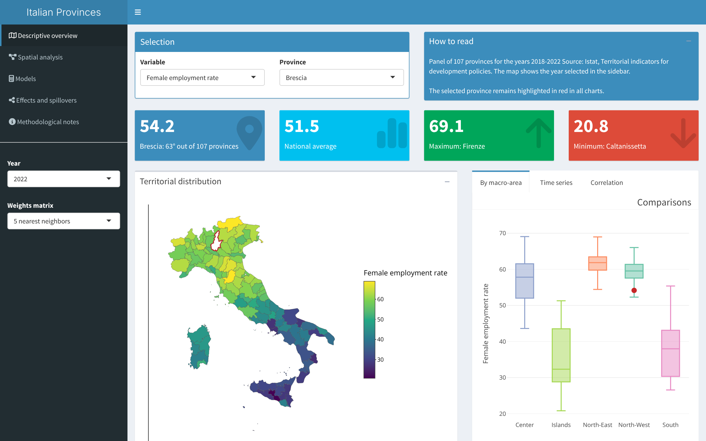
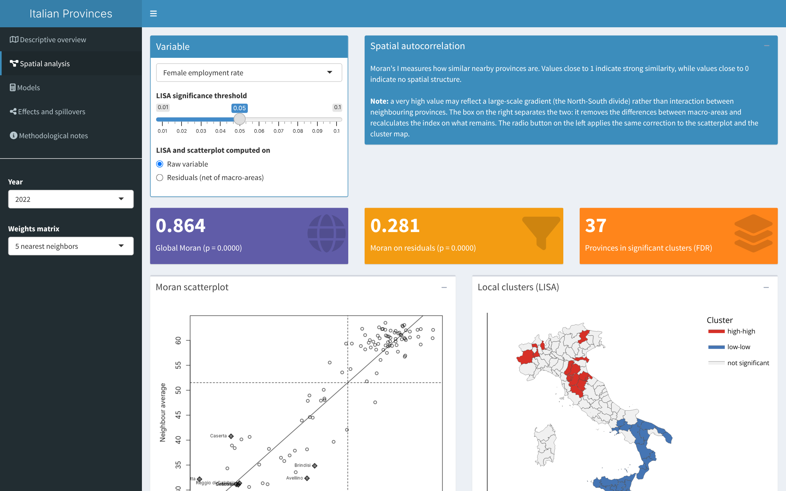
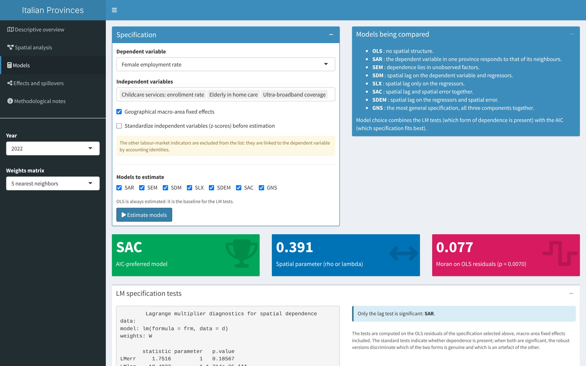
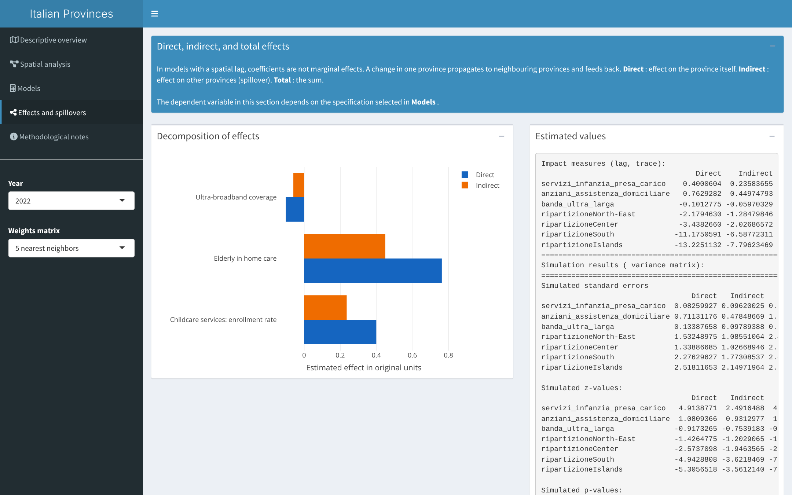

# Spatial econometrics dashboard: female employment and care services in Italian provinces

An interactive **R Shiny** dashboard to explore, map and model the spatial relationship between **female labour-market outcomes** and **care services** (childcare, home care for the elderly) across the **107 Italian provinces**, 2018–2022.

Joint project with Giacomo Pagani for the *Spatial Data Lab*, MSc in Analytics and Data Science for Economics and Management, University of Brescia (2026). Both authors contributed to every stage.
**▶ [Open the live dashboard](https://g-ferraresi.shinyapps.io/spatial-econometrics-dashboard/)** (it may take ~30 seconds to wake up)



## What the dashboard does

| Tab | Content |
|---|---|
| **Descriptive overview** | Choropleth map of any indicator, ranking of a chosen province, comparisons by macro-area, time series and scatterplots |
| **Spatial analysis** | Global Moran's I (also on residuals net of the North–South divide), Moran scatterplot, LISA cluster map with FDR correction, Moran's I by year |
| **Models** | OLS and seven spatial models (SAR, SEM, SDM, SLX, SAC, SDEM, GNS) with macro-area fixed effects; LM/robust LM specification tests, AIC/BIC comparison, likelihood-ratio tests between nested models |
| **Effects and spillovers** | Direct, indirect (spillover) and total effects with simulated standard errors |
| **Methodological notes** | User guide, data sources and modelling choices |

Year, weights matrix (5 nearest neighbours or queen contiguity), dependent variable and regressors are all selectable. Regressors can be standardised to compare their effects.

## Example: female employment rate, 2022

| Spatial analysis | Models |
|---|---|
|  |  |

With a 5-nearest-neighbour weights matrix:

- Female employment is strongly spatially clustered (**Moran's I = 0.86**). Much of this is the North–South divide, but significant autocorrelation remains after removing macro-area differences (I = 0.28): high-high clusters in the North and Centre, low-low clusters in the South.
- After controlling for macro-areas, the OLS residuals are still spatially correlated, and the LM tests point to a **spatial lag** structure.
- In the SAR model, a 1-point increase in the **childcare enrolment rate** is associated with a 0.40-point higher female employment rate in the same province (direct effect) and 0.24 points through neighbouring provinces (spillover). Both effects are significant.



These are cross-sectional associations, not causal effects.

## Modelling choices worth noting

- **No accounting identities on the right-hand side.** The five labour-market indicators are mechanically linked (e.g. the gender employment gap contains the female employment rate), so when one is the dependent variable the others are excluded from the regressors.
- **Separating large-scale trends from local interaction.** Moran's I is also computed on residuals net of macro-area fixed effects, so the North–South gradient is not mistaken for spillovers between neighbours.
- **Weights matrix.** With queen contiguity Sicily and Sardinia are disconnected from the mainland; the k-nearest-neighbours matrix reconnects them through centroid proximity.
- **Consistency checks.** The province order of each yearly slice is verified against the weights matrix before any estimation, and the models are re-estimated only on request, with a warning when the specification has changed.

## Data

| File | Content | Source |
|---|---|---|
| `data/panel_province_lavoro_cura.xlsx` | Panel of 107 provinces × 5 years, with a metadata sheet (Istat indicator codes, definitions, units) | Istat, *Territorial indicators for development policies* (Labour, Care services, Information society) |
| `data/ProvCM01012023_g_WGS84.*` | Province boundaries, 1 January 2023, generalised | Istat, boundaries of administrative units for statistical purposes |

Indicators: female employment and unemployment rates, gender gaps in employment and activity, labour-market participation, availability and enrolment rate of childcare services (0–2 years), elderly in home care, ultra-broadband coverage.

## How to run

```r
source("install_packages.R")   # first time only
shiny::runApp()
```

Run from the repository folder (in RStudio: open `global.R` and click *Run App*).

## Repository structure

```
├── global.R            # data loading, cartography, weights matrices, helper functions
├── ui.R                # dashboard layout
├── server.R            # maps, spatial statistics, model estimation, impacts
├── install_packages.R
├── data/               # Istat panel and shapefile
└── screenshots/
```
